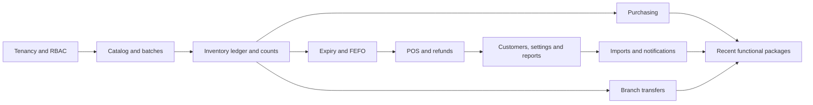

# PharmacyStock canonical fresh bootstrap

Status: **CANONICAL BOOTSTRAP PROVEN** for fresh isolated databases. The final two reviewed runs each execute all 53 files, pass all 25 SQL suites with zero failures/skips, and produce identical schemas. This is not staging or production deployment approval.

## Baseline and scope

Worktree: `C:\Users\Admin\.codex\worktrees\catalog-opening-stock\pharmacystock`.
Branch: `codex/catalog-opening-stock`; HEAD: `e3e390c58dcdf9203a67733c00b3ebbfd08b90fd`.
The original tooling-only bootstrap preserved 476 prior files. This assertion-resolution work separately fingerprinted 487 tracked/untracked baseline files. Only ten assertion suites, the existing CLI proof script, this document and the proof report changed from that baseline; the other 474 files remain byte-for-byte unchanged. All application/dependency files, all 53 historical migrations and the canonical manifest/main runner are intact. Two resolution evidence documents were added. The accumulated dirty working tree is preserved. No reset, clean, stash, branch switch, commit, push, merge or deployment occurred.

No production project was queried, linked, read or modified. No production schema or history was copied. No staging project, secrets or real Auth configuration was created. Repository governance describes a production-only project gate; this explicitly authorized isolated PostgreSQL work never selected any hosted project. Historical migration reconciliation remains a separate production workstream.

## Inventory and dependencies

There are exactly **53 migration files / 51 versions** in this accumulated baseline. The complete filename/version/module/object inventory and direct dependency/dependent lists are in [CANONICAL_BOOTSTRAP_INVENTORY.md](CANONICAL_BOOTSTRAP_INVENTORY.md). The executable adjacency list has 221 direct prerequisite/replacement edges in `supabase/bootstrap/manifest.json`.

Source hashes use UTF-8 SQL with LF newlines and an optional BOM removed, making Windows/Linux exports reproducible. Baseline-preservation fingerprints separately use original raw bytes. A missing/modified historical file, invalid dependency order, unknown old-version file or new duplicate version fails validation before any database starts.

Conceptual module order (exact file-level order is the manifest):



Historical timestamp problems verified independently of filenames:

| Dependent source | Required later source/object | Finding |
| --- | --- | --- |
| `20260823083100_sprint3_inventory_ledger.sql` | `20260823090000_sprint2_products_batches.sql`: `branches(organization_id,id)` uniqueness plus `batches` and its tenant key | Immediate FK/DDL blocker. Reproduced original `there is no unique constraint matching given keys for referenced table "branches"` on an empty database. Missing batches would be the next blocker. |
| `20260823083900_sprint3_inventory_hardening.sql` | Ledger's catalog prerequisite transitively | Cannot precede a valid ledger. |
| `20260823162813_sprint6_pos_security_boundary.sql` | `20260823170000_sprint6_pos_sales_foundation.sql`: sales/items/payments and original public sale function | PL/pgSQL body references can be deferred, so successful creation alone is misleading. Later foundation would also overwrite the public wrapper if left in timestamp order. |
| `20260823163500_sprint6_refunds_and_pricing.sql` | Same POS foundation: sales/items/refunds/refund items; `%rowtype` declarations and `ALTER TABLE sale_refund_items` | Immediate schema dependency and worker replacement order. |
| `20260823164500_sprint6_sale_quote.sql` | POS feature foundation logically; FEFO/batch pricing directly | Deferred feature prerequisite; kept after foundation/security/refund setup. |

All other qualified first-definition and replacement dependencies are satisfied by the manifest; full execution of every statement confirms there are no further clean-DDL failures in this repository baseline. Creation alone does not prove every deferred function branch; representative RPC execution and the complete green assertion gate below provide additional evidence.

Only two moves from filename order are needed: catalog/batches before the ledger; POS foundation before its security/refund/quote migrations. Later implementation replacements keep their existing order. No missing prerequisite was patched in by hand. No SQL file was excerpted or edited for bootstrap.

## Duplicate versions

| Version | Exact files | Both needed / ordering |
| --- | --- | --- |
| `20260823170000` | `20260823170000_sprint6_pos_sales_foundation.sql`; `20260823170000_sprint7_core_completion_foundation.sql` | Both required. They are dependent: core adds `sales.customer_id`, its FK and a sales read model. POS foundation must run first. |
| `20260823171000` | `20260823171000_sprint7_import_notifications_customer_sales.sql`; `20260823171000_sprint8_branch_transfers.sql` | Both required. Distinct domains with shared prior tenancy/catalog/inventory prerequisites; neither directly requires the other. The manifest fixes import/customer/notification work before transfers, eliminating any tie. |

No other duplicate versions exist. Neither historical file was renamed. A fresh canonical artifact represents all their actual SQL, without pretending the historical versions were individually applied by the CLI.

Installed Supabase CLI **2.117.0** was tested against a disposable loopback PostgreSQL database with independent config and no project link. After applying the real prerequisites, both genuine `20260823170000` files were submitted to the CLI. The first succeeded; the second rolled back with SQLSTATE 23505 on `supabase_migrations.schema_migrations_pkey`. Only the first genuine migration remained recorded. Thus filename tie ordering cannot solve version identity collisions. This also agrees with the upstream [migration history implementation](https://raw.githubusercontent.com/supabase/cli/v2.95.3/pkg/migration/history.go), whose version field is a primary key. The local 2.117.0 experiment, rather than that older source alone, establishes installed-version behavior.

## Strategies evaluated

| Strategy | Reproducibility / semantics | Production compatibility | Maintenance / staging / risk |
| --- | --- | --- | --- |
| A: repair historical replay order | Two prerequisite moves fix raw SQL ordering, but the CLI still cannot represent duplicate versions | Editing/renaming historical sources would complicate divergent deployed history | Insufficient on its own; historical-file mutation avoided |
| B: hand-maintained final schema snapshot | Could be deterministic, but must also preserve permission seed data, grants, function bodies and replacements | Can be fresh-only, but schema equivalence would need independent proof | Larger duplicated source of truth and regeneration burden; rejected for now |
| C: immutable complete-file manifest | Deterministic order and hash validation; executes every statement in all 53 files | Historical files and all existing histories remain untouched | Smallest defensible execution fix; chosen, with mechanically generated CLI artifact |
| D: existing selective fixture runners | Reorder/excerpt modules and manufacture smaller test schemas | No production mutation, but no complete-history semantics | Useful feature fixtures; cannot establish fresh bootstrap completeness; rejected as canonical proof |

Selected: **C**, with a generated single fresh-only CLI baseline as a packaging step. This is not a hand-authored schema snapshot. Each of the 53 source files appears intact once in the generated SQL, with source hash/provenance comments. The generated baseline and complete-file replay were both executed from empty application schemas and produced identical schema dumps.

## Exact local procedure

From the required worktree, with Python 3.10+ and Docker available:

```powershell
python scripts/canonical-bootstrap.py --validate
python scripts/canonical-bootstrap.py --runs 2
```

The PostgreSQL image is pinned to the tested immutable identity:
`postgres@sha256:a77aa70e641402a21411b92b721c58d10f23b50ae5fdd2333efd22d166e1e5f7`.
It must already be present; the runner never pulls an image automatically. Each main run starts a new network-disabled container with temporary storage and no published ports. It accepts no connection URL and reads no credentials or environment files. A test-only platform fixture supplies `auth.users`, `auth.uid()` and `anon`/`authenticated` roles. These platform scaffolds are not part of the generated application baseline.

Each run automatically:

1. Verifies every source hash and prerequisite edge before starting the database.
2. Requires an empty application schema; executes each complete source once in its own transaction.
3. Runs schema assertions and records the schema dump and object counts.
4. Executes the generated single-file baseline in another empty database and compares schema dumps.
5. Executes a 52-file baseline then the actual final controlled-import migration separately, and compares final schemas. No dummy migration is used.
6. Runs the ordinary application RPC smoke transaction.
7. Clones the clean full schema independently for each of the 25 SQL suites, executes each complete suite, and collects every result. The ten corrections are documented in the failure matrix; the runner never rewrites suite SQL.
8. Removes only its own disposable container, including on errors.

The final command exits **0** only after schema equivalence, application smoke and all suites pass. The original 15/25 reproduction remains recorded in the proof report and failure evidence.

To reproduce the original chronology failure separately:

```powershell
python scripts/canonical-bootstrap.py --chronological --runs 1
```

This is an expected failing diagnostic; the per-file log records the branches composite-FK error.

For the independent CLI/history proof, supply an already-installed executable:

```powershell
python scripts/canonical-cli-proof.py --cli <absolute-path-to-supabase.exe>
```

This creates its own disposable database with a randomly assigned **127.0.0.1-only** published port and separate local configuration. It uses explicit loopback database URLs, with inherited Supabase/Postgres connection variables removed. It does not use the repository's linked project or CLI defaults. It cleans up its own container and network. Unlike the main proof, it requires a local Docker bridge so the host CLI can reach the loopback port.

## Recorded result

Final reviewed repeat: two new empty database/container runs, all **53/53 files applied** and all **25/25 suites passed** each time. A preceding clean single run also passed 25/25. Original branches composite key and catalog/POS ordering failures are eliminated at their prerequisite source.

Normalized public/private schema SHA-256, identical in both runs and generated-baseline comparisons:
`d88585f0c0e19690c4345bda5f467872f3e9ad6e0abfeb36df7200fda0eded82`.
Normalization removes only PostgreSQL's random `\restrict` / `\unrestrict` transport tokens; it retains SQL definitions, grants, policies and triggers. This proves repository-schema equivalence, not equivalence to uninspected production.

Verified: **41 public tables, 7 public views, 129 public/private functions including extension functions, 170 indexes, 256 constraints, 39 application triggers**. Expected 48 relations and 92 distinct retained application function names exist. Material checks require the composite branch key, validated constraints, valid indexes, ledger immutability trigger, ledger RLS, private RBAC replacements and the deliberate absence of deprecated public RBAC helpers.

Coverage includes organizations, branches, organization/branch memberships, invitations, catalog/products/barcodes, suppliers, orders/lines/receipts, batches, movements/balances, physical counts, transfers/lines, sales/items/payments/refunds, customers, notifications/preferences, settings, imports, expiry/FEFO and report/read-model APIs. Presence checks are accompanied by representative RPC execution; they do not claim exhaustive execution of every function signature.

## All existing SQL suites

**Final: 25 passed / 0 failed / 0 skipped in each of two reviewed fresh runs.** Every suite runs in its own clone of the complete clean schema. Shared test prerequisites are explicit DML for four suites and an assertion helper for two; no test setup replaces application DDL, policies or workers.

The original fresh reproduction was **15 passed / 10 failed / 0 skipped**. Investigation found **0 real schema defects, 3 superseded assertions and 7 fixture/assumption defects**, with no unknown or cross-suite state dependency. No historical migration, application behavior, privilege or RLS correction was required. No assertion suite was deleted, skipped or relaxed to accept a schema defect.

See [CANONICAL_BOOTSTRAP_FAILURES.md](CANONICAL_BOOTSTRAP_FAILURES.md) for the ten-suite matrix and coverage review; [assertion-failure-evidence.json](../supabase/bootstrap/assertion-failure-evidence.json) retains exact original SQL/errors, expected/actual results, object/migration evolution, current app evidence and corrections.

Current suite-level results are exact. No per-assertion runtime count is claimed: the legacy suites are fail-fast SQL/PLpgSQL scripts without TAP execution counters. The old static count of 580 declaration sites described the pre-correction files, not an executed assertion total.

## Representative application compatibility

The added ordinary RPC smoke transaction passes **13 explicit checks**: retry-safe owner setup; barcode/catalog search; opening-stock retry and ledger balance; order/receiving retry and status; receiving/opening ledger count; FEFO batch pricing; reviewed checkout retry; stock consumption; cash payment/change; business-date sales report; final ledger/balance reconciliation. This is SQL/domain compatibility using the current application RPC signatures, not a claim of browser, real Auth or PostgREST end-to-end coverage.

The existing complete `daily_operations_acceptance.sql` also passes, covering import/opening stock, partial/final receiving, adjustments/counts, quarantine/recall/disposal, transfers, customer sales/refunds, reports and notification deduplication. All of it ran against the fully bootstrapped schema in each final run. Current package SQL coverage also passes for owner setup, catalog/barcodes/opening stock, purchasing/receiving, inventory/count reconciliation, transfers, quote/sale/refund, customers and reports. The existing application test run passes **109 files / 2,051 tests**; `npm run typecheck` and `git diff --check` pass. Dependencies and product files were not changed.

## Future migrations and trustworthy staging history

To generate a **new separate** migration workspace, without any connection:

```powershell
python scripts/canonical-bootstrap.py --export .expo/canonical-staging-candidate
```

The destination must not already exist. It contains a minimal unlinked config and:

`supabase/migrations/20261118215804_canonical_bootstrap.sql`

Future ordinary migrations stay in the repository's existing `supabase/migrations` directory, created with the installed CLI's normal `migration new` workflow. They need a unique version strictly greater than `20261118215804`. The exporter copies those forward files after the canonical baseline. It rejects retroactive/unreviewed old versions and new duplicate versions. The 53 pinned historical files never change or get replayed into an existing pharmacy database.

For a future approved staging setup, use only that separate generated workspace on a genuinely fresh non-production Supabase platform. The platform supplies Auth roles/schema; exclude the local platform fixture. Have the CLI **actually execute** the generated baseline and record its normal single `20261118215804 / canonical_bootstrap` entry. Subsequent forward migrations are executed/recorded normally. Never repair/insert 51 historical versions, mirror production's divergent rows, or mark unexecuted schema applied. Do not point the historical repository migration directory at new staging. Do not apply the canonical baseline to production or an existing schema: its guard refuses existing application relations/private schema.

Local CLI 2.117.0 proof succeeded:

- Actual execution of the complete generated baseline produced exactly one history entry: `20261118215804 / canonical_bootstrap`.
- Repeating migration-up was a no-op with unchanged history.
- A separate empty database executed a generated 52-source baseline (`20261118213001`) followed by the real `20261118215803_controlled_imports_onboarding.sql`; both were recorded by the CLI and its final schema was identical to the complete baseline. This uses real schema changes, not a dummy migration.
- After the complete 53-source baseline, the CLI creates and actually executes a later `canonical_forward_probe` migration in its disposable export only. It changes a schema comment, verifies the SQL side effect and exact two-entry history, then confirms a repeat is a no-op. This metadata probe never enters product migrations. The separate real controlled-import migration above supplies substantive forward-DDL equivalence evidence.
- Genuine historical duplicate files caused the primary-key collision described above.

This establishes full-baseline plus ordinary later migration/history behavior locally. No history entry is manually inserted/repaired, and all recorded entries correspond to executed files. It does not approve or create staging. Production keeps its own existing history and only future approved forward migrations; its historical drift is neither repaired nor concealed here.

## Original bootstrap files added

- `docs/CANONICAL_BOOTSTRAP.md`
- `docs/CANONICAL_BOOTSTRAP_INVENTORY.md`
- `scripts/canonical-bootstrap.py`
- `scripts/canonical-cli-proof.py`
- `supabase/bootstrap/application-smoke.sql`
- `supabase/bootstrap/assertion-helper.sql`
- `supabase/bootstrap/manifest.json`
- `supabase/bootstrap/platform-fixture.sql`
- `supabase/bootstrap/proof-report.json`
- `supabase/bootstrap/schema-assertions.sql`
- `supabase/bootstrap/suite-fixture.sql`

## Evidence, self-review and handoff

Machine-readable summary: `supabase/bootstrap/proof-report.json` (full suite errors, schema/object counts, both repeat runs, CLI history proof and static assertion inventory).

Detailed ignored local evidence:

- `.expo/canonical-bootstrap-evidence/proof-71503b28cf/`: both fresh runs, per-source logs, normalized schema dumps, schema/RPC checks and all suite logs.
- `.expo/canonical-bootstrap-evidence/cli-c0b2e261ea/`: actual generated CLI workspaces and baseline/no-op/forward/duplicate logs.
- `.expo/canonical-bootstrap-evidence/baseline.json`: 476 original raw-byte fingerprints.

Self-review corrected new-tooling issues before handoff: Python quoting, obsolete public-helper presence expectations, missing second-branch test setup and CLI JSON-error stream parsing. The public-helper correction now positively requires their intentional absence plus private replacements, based on historical RBAC migration lines 310–312. Original SQL suites and product behavior remain unchanged. Automatic review initially rejected a proposed removal-only check correction; the stronger presence/absence invariant was subsequently approved and executed.

`python -m py_compile` and source/manifest validation pass. `git diff --check` passes (Git reports pre-existing line-ending normalization notices). Application dependency installation/export/native checks were not run for this SQL/bootstrap-only addition; no dependency file was modified. No hosted advisor was invoked because production access is prohibited and no RLS/grant behavior was changed.

Remaining blockers: 10 existing suite failures, no complete green assertion gate, and no honest per-assertion runtime count. Exact next action: investigate those ten full-schema assertion failures in a separate scoped local workstream, retain all bootstrap invariants, prove any obsolete fixture/expectation before editing it, then rerun the same two-empty-database gate. Do not create paid staging until the gate is green.

## Assertion-resolution files

Modified: the ten SQL suites listed in the [failure matrix](CANONICAL_BOOTSTRAP_FAILURES.md), `scripts/canonical-cli-proof.py`, this document and `supabase/bootstrap/proof-report.json`.

Added: `docs/CANONICAL_BOOTSTRAP_FAILURES.md` and `supabase/bootstrap/assertion-failure-evidence.json`. Disposable raw logs, original suite snapshots, byte fingerprints and final run dumps are retained under `.expo/canonical-bootstrap-evidence` and referenced by the proof report; they contain no hosted credentials.

Production compatibility: this solution requires **no production migration-history edits, no historical replay and no corrective bootstrap SQL against production**. It is exclusively for fresh environments followed by ordinary future forward migrations. No hosted project, paid staging, real Auth, staging secret or deployment was created/configured/accessed. Hosted Auth/PostgREST and browser/native E2E remain outside this local database proof. Stop this workstream here. The next action is review of the local changes and evidence; any staging work requires a separately authorized task.
